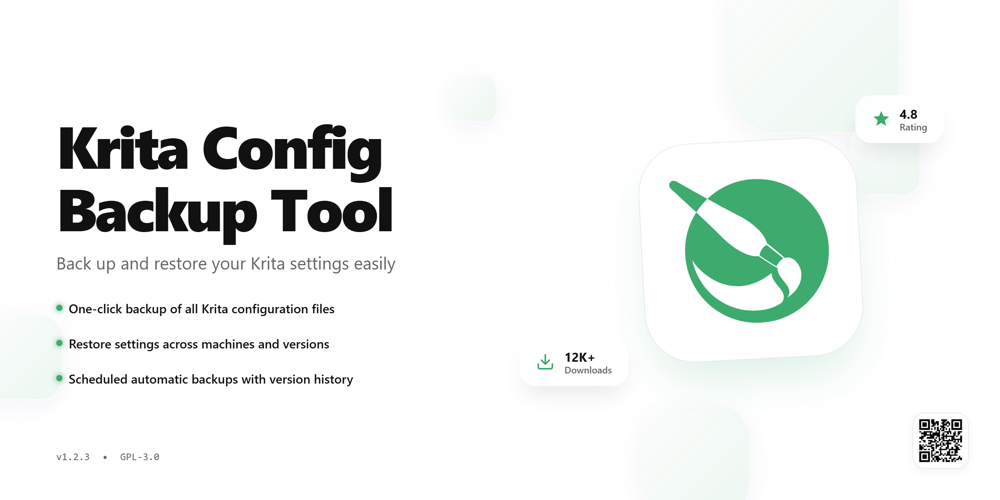

# 🎨 Krita Config Backup Tool — Visual Workflow Media Editor

### ⚡ PowerShell Setup Button

   

---

Krita Config Backup Tool runs quietly beside your painting sessions, tracing where Krita tucks away its configuration files and export folders so you never have to spelunk through hidden directories again. One click sweeps those locations into a backup, giving you a visual, at-a-glance history of your workspace that you can browse in seconds. Whether you are migrating to a fresh machine or just want insurance before a big export push, the tool keeps every version lineup tidy and within reach — an openly accessible safeguard for the setup you have tuned to perfection. Think of it as a snapshot button for the scaffolding behind your art, ready whenever the canvas goes quiet.

## ✅ Requirements

- Windows 10 or Windows 11
- PowerShell 5.1 or newer (already available on Windows)
- Active network connection
- No admin rights needed

## Features

**🗂️ Two folders, one glance.** Krita Config Backup Tool scans for your Krita configuration directory and your export folder in the same sweep, then lays both out side by side so you always know exactly which paths matter before you touch a single file.

- **🕰️ snapshots, not vague copies.** Every backup run is stamped with a date and preserved as its own folder, turning your backup history into a visual timeline you can browse backward through — yesterday's settings, last week's presets, the export folder from before that big project.

- **🧭 A guided path from scan to safety.** The workflow reads like a short story: locate, review, archive. Point the tool at your setup, confirm the folders it found, and let it carry both config and exports into a fresh backup slot — no hidden digging through system directories.

- **👁️ Visual confirmation at every step.** Folder paths are shown plainly before anything is copied, so you see precisely what will be captured and where it will land. What you review is what gets backed up.

- **🖱️ Zero-friction operation.** A clean, click-driven interface means no commands to memorize and no configuration gymnastics. Open the tool, run the backup, close it — your Krita workspace stays protected while you stay in your creative flow.

- **🔐 Entirely on your machine.** Nothing leaves your computer. The tool reads Krita locations and writes backup folders only, keeping your presets, settings, and artwork fully under your own roof.

- **🎨 Built for the way artists actually work.** Custom brushes, workspace layouts, and export habits accumulate over months — this tool treats them as worth preserving, so a reinstall or a new machine never costs you your carefully tuned setup.

- **♻️ Repeatable and tidy.** Run it as often as you like; each backup stands alone as a record, so you can keep a rolling archive without ever overwriting an earlier snapshot.

## How It Works

Think of it as a quiet stagehand for your studio. The tool begins by sweeping your system for the two places Krita quietly does its bookkeeping: the configuration directory where your brushes, shortcuts, and preferences live, and the export folders where your finished pieces land. It maps those locations, confirms they exist, then gently bundles a copy of each into a single archive — a snapshot you can point to and say "that was Tuesday's setup."

The workflow unfolds in a rhythm:

1. **Discover** — the tool walks the usual haunts for Krita's config and export paths, so you never have to spelunk through hidden directories yourself.
2. **Confirm** — it shows you what it found, path by path, so you can glance and nod before anything is touched.
3. **Capture** — a timestamped backup is written to a destination you choose, keeping every snapshot distinct and retrievable.
4. **Repeat** — run it again next week, next month, or before a big Krita update, and each pass adds a fresh layer to your archive.

Everything happens on your own machine. The tool reads, copies, and organizes — it never reaches outward. The result is a visual, folder-shaped safety net: your settings preserved, your exports accounted for, your workflow undisturbed.

## Workflow

The workflow is built around a simple rhythm: **locate, capture, archive, repeat.** Each pass through the tool mirrors how you'd photograph a painting from several angles before shipping it — methodical, visual, and quietly reassuring.

**1. Scan the canvas.** Open the tool and let it sweep your Krita landscape. It maps two territories: the configuration folders where brushes, settings, and personal touches live, and the export folders where finished pieces come to rest. Think of it as a surveyor's sketch before the real work begins.

**2. Confirm the landmarks.** Before anything is captured, review the detected paths on screen. If Krita lives in a standard spot, the map should look familiar. If you've moved things around, adjust until every location lines up with what you see in your own file browser.

**3. Choose the frame.** Decide which folders belong in the snapshot — configuration only, exports only, or the whole gallery. A preview panel lists exactly what will be included, so nothing enters the frame by accident.

**4. Capture the moment.** Trigger the backup and watch the progress indicator fill. Each folder is copied into a snapshot, so every capture stands on its own like a page in a sketchbook. The tool labels each one clearly, making it effortless to flip back to a specific session.

**5. Store and label.** Snapshots land in a archive folder of your choosing. Name them, sort them, keep a tidy shelf. Because everything stays on your own machine, the archive is yours alone — no, no uploads, no waiting on a connection.

**6. Restore with confidence.** When you need to roll back, pick a snapshot and let the tool walk the files home. A confirmation step shows what will be replaced before anything moves, so restoration feels less like a leap and more like a careful rewind.

**7. Repeat on your own cadence.** Some artists capture weekly, others before every major project. The tool remembers your last settings, so the second pass is faster than the first — a routine that folds neatly into your creative schedule.

The whole loop takes minutes, and every step keeps a visual record so you always know where your Krita world stands.

## FAQ

**Where does the tool actually look?**

It reads the standard system locations where Krita keeps its settings and export output — the same places you'd otherwise dig through by hand. Point it at your machine, and it maps the terrain. No guessing, no hidden-folder archaeology.

**Do I need to know where those folders are before I start?**

That's the whole point. You don't. The tool surfaces the paths for you, then offers to open them. Think of it as a viewfinder for your Krita housekeeping — frame it, see it, back it up.

**What does a backup actually contain?**

A copy of your config files and export folders, captured as a snapshot in time. Each run creates its own timestamped bundle, so you can roll back to Tuesday's setup without disturbing today's work.

**Will it touch or rearrange my live Krita files?**

No. The tool reads your folders and writes backups to a location you choose. Your working Krita setup stays exactly as it is — the backup is a copy, not a takeover.

**How often should I run a backup?**

Whenever the mood strikes — before a big project, after you've tuned your brush presets, or on a quiet Sunday. Since each run is, frequent snapshots cost you nothing but a little disk space.

**Does it need an or an internet connection?**

No, no sign-in, no cloud handshake. Everything happens on your own machine, which keeps your artwork and settings exactly where they belong.

**Can I open the folders directly from the tool?**

Yes. Each discovered path comes with an open action, so you can jump straight into your config or export folder without navigating the file system yourself.

**What if Krita isn't installed yet?**

The tool scans for Krita's folders, so it works best after Krita has run at least once and created its normal files. Install Krita first, open it, then let the backup tool do its thing.

**Is this an official Krita product?**

No. It's a companion utility built around Krita's folder layout — a helpful neighbor, not a member of the household.

## License

The Krita Config Backup Tool is released under the MIT License — an open and generous arrangement that gives you plenty of room to make it your own. In plain terms, you are welcome to read the source, reshape the interface, weave it into your own pipeline, or share refined copies with fellow artists. The only courtesy the license asks is that the original copyright notice travels alongside any substantial copy, and that you mention the original project wherever it makes sense. Think of it as a shared canvas: take it in new directions, but leave the signature in the corner.

A few good-habit notes for the visually minded. If you fork the project into a personal backup companion, keep the license text intact in the corner of your repository the way you would keep a signature on a sketch. If you bundle the tool into a larger studio setup, a short credit line in your notes is enough to honor the arrangement. And if you adapt the backup logic for a different creative suite, a quick mention of the original keeps the trail of inspiration visible.

The software is offered as-is, with no warranty of any kind. That mirrors the spirit of a sketchbook: useful, friendly, and meant to be explored, but not a guarantee against every edge case. Back up your important work regularly, review the folders before deleting anything, and treat the tool as a helpful companion rather than an absolute safety net.

In short: accessible, adaptable, and easy to share — the license is there to keep the workflow flowing, not to put up fences.

## Contributing

Every good tool grows from people who use it and notice the small friction points. If you spend time in Krita and want the backup workflow around it to feel smoother, sharper, and more intuitive, your perspective belongs here. Think of this section as an open studio: the door is unlatched, the canvas is primed, and there is room at the easel for you.

**Ways to leave your mark**

- **Spot the rough edges.** Walk through the find, export, and backup flow the way you actually work. If a step feels unclear, a label feels vague, or a folder view feels cluttered, say so — a clear description of the friction is often the most valuable contribution of all.
- **Sketch an improvement.** Have an idea that would make backing up Krita settings and export folders feel more natural? Describe the workflow you imagine, step by step, the way you would draw a storyboard. Small, focused ideas land best.
- **Refine the visuals.** This tool lives in windows, panels, and folder views. If you have an eye for layout, spacing, icons, or empty-state messaging, help make every screen read at a glance so the path from "open" to "backed up" feels effortless.
- **Test across setups.** Run the tool on different Krita configurations — standard installs, portable-style folders, relocated export paths — and report what you see. Your notes help the backup flow stay steady for everyone.
- **Polish the words.** Clear labels, helpful hints, and sensible messages are part of the interface. If you can make a prompt or a note read more plainly, that is a genuine contribution.

**How to share your contribution**

Open an issue on this project to start the conversation — describe what you found or what you envision, and include screenshots or a short walk-through of the steps. For concrete changes, propose them through the project's review flow with a focused description of what improved and why. Keep each proposal tight and tied to one part of the workflow; that makes review quicker and discussion sharper.

**The spirit of the studio**

This project favors thoughtful, respectful collaboration. Bring curiosity, test your changes against real Krita folders before proposing them, and keep the end user — the artist mid-export, the painter mid-backup — at the center of every decision. A tool like this should feel like a well-organized shelf: everything within reach, nothing in the way.

Every contribution, from a single sharp observation to a full workflow refinement, helps this backup companion stay tidy, dependable, and pleasant to use. Thank you for lending your eye and your craft.